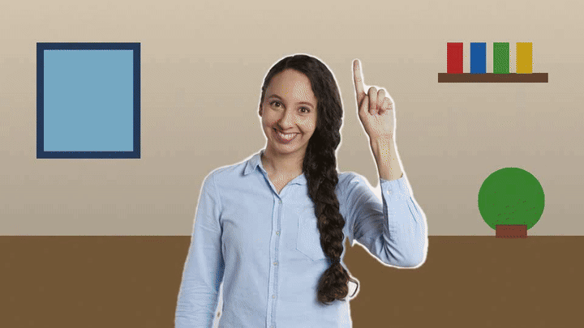
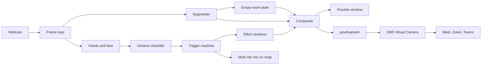

# Meetingport

**Do an anime hand sign on camera and vanish from the call. Your empty room stays on screen.**

An open palm brings you back. Meetingport runs on your computer and sends the picture to a virtual camera that Google Meet, Zoom, and Microsoft Teams already know how to use.

You need an access password from the person who shared Meetingport with you. The installer asks for it before it installs anything.


*Snap to dust. A finger snap breaks you into particles. The empty room stays. An open palm brings you back.*



*Naruto substitution (Kawarimi). Smoke, then a wooden log falls into your chair.*

Inspired by [@nicosmartworking](https://github.com/Nicovic17)'s Meetingport reel and Raj Patel's snap reel. This is an independent rewrite: no copied code and no anime assets. Full credits are at the bottom.

## Contents

- [The idea](#the-idea)
- [Gestures](#gestures)
- [How it works](#how-it-works)
- [Access password](#access-password)
- [Quick start](#quick-start)
- [Shortcuts](#shortcuts)
- [Configuration](#configuration)
- [Command line](#command-line)
- [Permissions](#permissions)
- [Troubleshooting](#troubleshooting)
- [Privacy](#privacy)
- [Contributing](#contributing)
- [Tests](#tests)
- [Credits](#credits)
- [License](#license)

## The idea

Video calls show whatever the webcam sees. Meetingport sits between the webcam and the call. You make a hand sign, an effect plays, and the picture the meeting receives is your room with you removed. The call keeps running. You are still in the chair. The other people see the empty room, a wooden log, or a cosmic backdrop, depending on the sign.

Everything stays on the machine: the camera frames, the hand tracking, the effects, and the mute. The only download is a few megabytes of MediaPipe model files, once, the first time you run it.

## Gestures

Hold a sign until the small ring near your hand fills. The ring is drawn in the preview window. The meeting sees it only if you set `ring_in_output` to `true`. Each sign has to be held for its own time. A different sign starts the charge over. After any effect there is a 2 second cooldown (`cooldown`). A tracking dropout shorter than 0.25 seconds is ignored. If the sign stays lost, the charge drains at twice the fill rate.

| Gesture | How to do it | What the call sees |
|---|---|---|
| **Goku Instant Transmission** | Index and middle fingers straight and together, tips on your forehead. Hold **0.7 s**. | A blue-white aura and rising speed lines, a flash, a flickering afterimage, then you are gone (about 1.0 s). |
| **Naruto substitution** (Kawarimi) | Both flat-ish palms pressed together in a seal in front of your chest (at least two fingers extended on each hand). Hold **0.6 s**. | A smoke puff (about 1.3 s). A wooden log falls in from above with a short bounce and lands centered on where you were sitting (`substitution_drop_seconds`, `substitution_drop_height`), with a soft contact shadow. Set `naruto_substitution` to `"none"` for the empty room, or `"image"` and point `substitution_image` at a PNG with alpha. `substitution_scale` resizes it. Press `L` in the preview to cycle. The open-palm return hides the log under the same smoke. |
| **Gojo Infinite Void** | Index and middle fingers crossed. Hold **0.8 s**. | A dark sphere grows from your hand over about 1.1 s into a starfield and nebula. You stay fully visible, with a soft rim light. The domain stays until you make the Gojo sign again or hold an open palm. Set `gojo_void_seconds` to a positive number and it collapses that many seconds after it is fully open. `gojo_void_caption` (on by default) fades the title in and out. |
| **Shadow Clone** | Both hands up, each with index and middle fingers straight and the ring and pinky curled. Lay one hand's two fingers across the other's so they make a plus or an X. Hold **0.7 s**. | Smoke, then 2 live copies of you (4 when there is room on both sides). They copy your movement until you make the clone sign again or hold an open palm, which dismisses them in smoke. You stay visible the whole time. |
| **Kamehameha** | Heels of both hands together in front of you, fingers open and spread or cupped, fingertips of the two hands apart (an open mouth, not the flat Naruto seal). Hold **0.7 s**. | A blue ball charges between your hands, then a blue-white beam crosses the frame with bloom and a small shake (about 1.9 s). You stay where you are. One shot. |
| **Snap to dust** | Hold a snap-ready pinch (thumb on the middle fingertip, ring and pinky curled, index not an open palm) for about **0.10 s**, then flick the middle finger sharply toward the palm within about **0.28 s**. The hand should stay roughly still, and only one hand should be in view. Or press `S`. | You break into coloured flakes that drift away over about 2 s (`snap_particles`, default 6000). The empty room remains. The microphone is muted at the same time (see [Auto-mute](#auto-mute)). An open palm plays it in reverse and unmutes you. Set `snap_reveal` to `"log"` to leave a falling Kawarimi log instead of the empty room. |
| **Reappear** | Open palm, all five fingers spread. Hold **1.0 s**. While you are already gone, holding Goku, Naruto, or Snap again also brings you back. | The last vanish effect plays in reverse (a little faster: 0.85×, except Gojo, which uses the same timing). |

A few rules keep signs from stepping on each other:

- Vanish signs (Goku, Naruto, Snap) and the palm are the ones that remove you or bring you back. While you are gone, Gojo, Shadow Clone, and Kamehameha do nothing.
- Gojo never removes you. It toggles Infinite Void. While the void is open, Shadow Clone and Kamehameha still play on top of it. Goku, Naruto, and Snap are ignored until the domain is dismissed. An open palm dismisses the void first. If clones are also out, a second palm dismisses the clones.
- While clones are out and the void is closed, the clone sign, an open palm, or the Gojo sign are the signs that do something. Vanish and Kamehameha wait until the clones are gone.
- Two-hand signs are checked before one-hand signs, so the clone sign is not read as Gojo's crossed fingers. While both hands are visible (`snap_one_hand_only`, default on), the snap detector stays off so a forming Naruto, clone, or Kamehameha seal is never stolen by a dust dissolve.
- The snap is a motion with a short pinch dwell, not a held pose. It fires when the flick finishes. There is no charge ring to fill. `hold.snap` stays `0`. Brief thumb-middle taps and waving wrists while talking do not count.
- Keyboard keys fire immediately. The hold times above are for the camera.

Sounds are synthesized by the app (`mport/sounds.py`) and play on your speakers. They are not sent into the call.

## How it works



1. **Segmentation.** The MediaPipe selfie segmenter cuts you out of the frame. `--segmenter diff` uses the older background-difference path when the model is a poor fit (a locked-off camera and steady light).
2. **Clean plate.** On startup the app spends `plate_seconds` (default 4) learning the empty room. Each pixel is averaged only from frames where you, a margin for soft edges, and your nearby shadow are not covering it. The preview shows a countdown and a red "You're still in frame" warning while the person mask covers more than 2% of the frame. Those frames are thrown out, and the capture keeps going until nearly every pixel has enough clean samples, up to 3× the requested time. Pixels that were never seen are filled in. After that the plate is frozen. Continuous learning is off because it used to paint ghosts of you into the wall. Set `plate_learn` to `true`, or pass `--plate-learn`, to let the plate follow slow lighting changes in pixels that are already close to the plate and far from you. Press `B` for a fresh capture: a `recapture_countdown` (default 3 s) warning, then the same clean capture.
3. **Gestures.** MediaPipe Hand Landmarker (two hands) plus BlazeFace. The face box supplies the forehead for the Goku check. `mport/gestures.py` is the classifier and the trigger state machine, in plain Python, so the tests can drive it without a camera.
4. **Effects.** NumPy and OpenCV particles, blended with alpha (`mport/effects.py`). Vanish effects are a function of time, which is why reappear can play them backwards. The snap samples flakes from your pixels at the trigger moment and moves them through a noise field. The Infinite Void backdrop (`mport/void.py`) is precomputed and drawn under the person mask.
5. **Auto-mute.** A snap vanish mutes the microphone. The open-palm return restores it. Details are in [Auto-mute](#auto-mute) and [Permissions](#permissions). Recorded files and the test clips never touch the real microphone.
6. **Snap trigger.** `snap_trigger` chooses what counts as a snap:
   - `"gesture"` (default): a deliberate pinch-and-flick only (`mport/gestures.py`). Requires a short pinch dwell, a sharp middle-finger flick, a fairly still wrist, snap-ready finger posture, and (by default) a single visible hand.
   - `"audio"`: a short, bright click on the microphone (`mport/audio.py`). Needs `sounddevice` and a working mic.
   - `"both"`: the gesture and a click within 300 ms.
   - `"either"`: the gesture or a click.
   If the microphone cannot be opened, audio, both, and either all switch to the gesture and the app prints `snap trigger falling back to gesture (no mic)`. Two visible hands also block the snap so a Naruto seal can form.
7. **Output.** pyvirtualcam writes frames to a virtual camera: OBS Virtual Camera on macOS and Windows, v4l2loopback on Linux. A preview window is on by default. `--out clip.mp4` also records the result.

The MediaPipe model files (Apache-2.0) download into `models/` on first use. That folder is gitignored.

| Path | What it is |
|---|---|
| `meetingport.py` | Starts the app. |
| `mport/` | Perception, gestures, effects, void, substitution, mute, audio, sounds. |
| `config.json` | The settings `./run.sh` and `run.bat` load. |
| `sounds/` | Synthesized effect audio. Regenerated if a file is missing. |
| `docs/` | Demo GIFs. |
| `v1/meetingport_v1.py` | The earlier background-difference prototype. The supported fallback is `--segmenter diff`. |

## Access password

Meetingport asks for an access password before it will install, and again before it opens a live camera or the virtual camera.

- `./run.sh` and `run.bat` ask first. Three wrong answers stop the install.
- A correct password is handed to that launch, so the app does not ask a second time.
- Running `python meetingport.py` yourself asks when the source is a camera index (`"0"`) or when `virtualcam` is true.
- Video files, which is what the tests use, do not ask.
- The password is not written in this repository. Ask the person who gave you the project.

You can also set `MEETINGPORT_PASSWORD` for a single launch. A wrong value in that variable is rejected without a prompt, so a stale value will stop the app until you unset it.

## Quick start

You need:

- Python **3.10, 3.11, or 3.12** (3.12 is the one to install if you are choosing)
- A webcam
- OBS Studio 30+ on macOS or Windows, or v4l2loopback on Linux
- The access password

`config.json` in this repo is the file the installers load. Edit it to change the camera, the size, or which effects are on. Every key is listed under [Configuration](#configuration).

### macOS

1. Install Python 3.12: `brew install python@3.12`, or the installer from [python.org](https://www.python.org/downloads/). If `./run.sh` cannot see it, run `PYTHON="$(brew --prefix python@3.12)/bin/python3.12" ./run.sh`.
2. Install [OBS Studio](https://obsproject.com/) 30+ (`brew install --cask obs`). Open it once, click **Start Virtual Camera**, approve the system extension under **System Settings → Privacy & Security**, then **Stop** and quit OBS. That registers the "OBS Virtual Camera" device. You do not need OBS running afterwards.
3. In this folder:

   ```bash
   chmod +x run.sh
   ./run.sh
   ```

   Type the access password when asked. The first run creates `.venv` and installs `requirements.txt`.
4. macOS asks for Camera permission for Terminal, iTerm, or the editor you launched it from. Allow it, then run `./run.sh` again.
5. When the preview says to step out, leave the frame until it says the background is captured. Then sit down.
6. In the meeting, pick **OBS Virtual Camera** (see [Choose the camera in the call](#choose-the-camera-in-the-call)).
7. Hold a sign until the ring fills.

Another camera index: `./run.sh --source 1`. A lighter frame size: `./run.sh --width 960 --height 540`.

### Windows

1. Install Python 3.12 from [python.org](https://www.python.org/downloads/) and tick **Add python.exe to PATH**. Install [OBS Studio](https://obsproject.com/) 30+. Open OBS once, click **Start Virtual Camera**, stop it, and quit OBS.
2. Double-click `run.bat`, or from a Command Prompt in this folder run `run.bat`. Type the access password. The window stays open if setup fails, so you can read the message.
3. Allow the camera if Windows asks (**Settings → Privacy & security → Camera**).
4. Step out for the empty-room capture, sit back down, and pick **OBS Virtual Camera** in the meeting app.
5. Another webcam: `run.bat --source 1`.

Volume mute on Windows needs two extra packages inside the virtual environment, after the first successful install:

```bat
.venv\Scripts\python -m pip install pycaw comtypes
```

Without them the snap still plays. The app logs that it could not mute and keeps going.

### Linux

1. Install Python 3.12 and its venv package. On Debian or Ubuntu:

   ```bash
   sudo apt install python3.12 python3.12-venv
   ```

2. Install a virtual camera and load it so browsers will accept it:

   ```bash
   sudo apt install v4l2loopback-dkms
   sudo modprobe v4l2loopback devices=1 exclusive_caps=1
   ```

   `exclusive_caps=1` is what makes Chrome list the device as a camera. OBS Studio can also feed that device if you prefer OBS to v4l2loopback directly.

3. Launch:

   ```bash
   chmod +x run.sh
   ./run.sh
   ```

4. For the audio snap on Linux, install PortAudio so `sounddevice` can open the mic: `sudo apt install libportaudio2`. The default gesture snap does not need it. PulseAudio or PipeWire's `pactl` is what the volume mute uses (`pulseaudio-utils` or `pipewire-pulse`).

### Choose the camera in the call

Start Meetingport and wait until the preview is up, then pick the camera. Many apps only list a virtual camera while something is feeding it.

| App | Where |
|---|---|
| Google Meet | Settings → Video → Camera → **OBS Virtual Camera** |
| Zoom | Settings → Video → Camera → **OBS Virtual Camera** |
| Microsoft Teams | Settings → Devices → Camera → **OBS Virtual Camera** |

In Chrome, reload the Meet tab if the camera is missing. Quit and reopen Zoom or Teams if the device was created after the app launched.

### Another way to install

`./run.sh` and `run.bat` are the path to use. If you want a `meetingport` command on your `PATH`:

```bash
python3.12 -m venv .venv
source .venv/bin/activate          # Windows: .venv\Scripts\activate
pip install -e .
meetingport --config config.json
```

That command still asks for the access password before it opens the camera. `pip install -e .` reads `pyproject.toml` and installs the same pins as `requirements.txt`.

## Shortcuts

The preview window has to be focused.

| Key | Action |
|---|---|
| `G` | Goku Instant Transmission |
| `N` | Naruto substitution |
| `S` | Snap to dust |
| `J` | Gojo Infinite Void. Press again to dismiss. |
| `C` | Shadow Clones. Press again to dismiss. |
| `K` | Kamehameha |
| `V` | Vanish with the last vanish effect. Goku until you have used another. |
| `R` | Reappear, or dismiss the void, or dismiss the clones |
| `L` | Cycle the Naruto substitution: log, empty room, and a custom image when `substitution_image` is set |
| `B` | Recapture the background. Countdown, then step out. |
| `H` | Hide or show the charge ring in the preview |
| `Q` or `Esc` | Quit. If a snap had muted the mic, quitting restores it. |

While you are already gone, every key except `J` brings you back. `J` does nothing until you are visible again.

## Configuration

`config.json` is loaded with `--config`. Command-line flags override it. If you run `python meetingport.py` with no config file, the built-in defaults apply (`virtualcam` and `mirror` are off in that case). `./run.sh` and `run.bat` always pass `config.json`, where both are on.

Values below are the ones shipped in `config.json`. Keys marked *built-in* are absent from that file and fall back to the code default when omitted. Older config files still load: missing `hold` keys are filled in, and unknown snap or substitution values are coerced back to the defaults.

| Key | Shipped value | What it does |
|---|---|---|
| `source` | `"0"` | Camera index, or a path to a video file. |
| `width` | `1280` | Requested capture width. The camera may choose a nearby mode. |
| `height` | `720` | Requested capture height. |
| `fps` | `30` | Requested capture frame rate. Effect timing follows the wall clock. |
| `segmenter` | `"mediapipe"` | `"mediapipe"` or `"diff"`. |
| `plate_seconds` | `4` | Empty-room capture at startup. `0` skips it. The capture can run up to 3× this long. |
| `plate_learn` | `false` | Keep updating the plate after the capture. Off, so a missed mask cannot paint you into the room. |
| `enabled_effects` | goku, naruto, gojo, clone, kamehameha, snap | Effects the camera is allowed to fire. The open palm is always available and is not in this list. |
| `hold.goku` | `0.7` | Seconds the Goku sign must be held. |
| `hold.naruto` | `0.6` | Seconds the Naruto seal must be held. |
| `hold.gojo` | `0.8` | Seconds the crossed-finger sign must be held. |
| `hold.palm` | `1.0` | Seconds the open palm must be held. |
| `hold.clone` | `0.7` | Seconds the clone sign must be held. |
| `hold.kamehameha` | `0.7` | Seconds the Kamehameha cup must be held. |
| `hold.snap` | `0.0` | Unused by the flick detector. The snap fires when the flick completes. |
| `cooldown` | `2.0` | Seconds after an effect before another can charge. |
| `sound` | `true` | Play synthesized effects on your speakers. |
| `virtualcam` | `true` | Send frames to the virtual camera. |
| `mirror` | `true` | Flip the preview and the output horizontally, so a raised right hand looks like a mirror. |
| `ring_in_output` | `false` | Also draw the charge ring into the virtual camera. Off, the ring stays in the preview. |
| `gojo_void_seconds` | `0` | How long the domain stays fully open. `0` means until you dismiss it. |
| `gojo_void_caption` | `true` | Draw the "Domain Expansion: Infinite Void" title. |
| `naruto_substitution` | `"log"` | `"log"`, `"none"` (empty room), or `"image"`. |
| `substitution_image` | `""` | PNG with an alpha channel, used when the mode is `"image"`. |
| `substitution_scale` | `1.0` | Size multiplier for the log or the custom image. A value `<= 0` is treated as `1.0`. |
| `substitution_drop_seconds` | `0.55` | How long the Kawarimi log takes to fall in (gravity ease-in + a short bounce), timed with the smoke. `0` seats it immediately. |
| `substitution_drop_height` | `1.15` | Drop start height as a multiple of the log height. The log lands on the person's last seat. |
| `snap_trigger` | `"gesture"` | `"gesture"`, `"audio"`, `"both"`, or `"either"`. |
| `snap_reveal` | `"room"` | What a snap leaves behind: `"room"` or `"log"`. |
| `snap_particles` | `6000` | Flakes in the snap. Clamped to 200–20000. |
| `snap_auto_mute` | `true` | Mute the microphone when a snap vanish fires on a live camera. |
| `auto_unmute_on_reappear` | `true` | Restore the microphone when you reappear after a snap. |
| `snap_pinch_frac` | `0.18` | Thumb-middle distance, in hand sizes, that counts as a snap pinch. Smaller is stricter. |
| `snap_min_pinch` | `0.10` | Seconds the snap-ready pinch must be held before a flick can complete. |
| `snap_flick_window` | `0.28` | Max seconds from pinch release to a completed flick. |
| `snap_min_sep` | `0.38` | Thumb-middle separation after the flick, in hand sizes. |
| `snap_min_travel` | `0.30` | Middle-tip travel toward the palm, in hand sizes. |
| `snap_max_wrist_move` | `0.12` | Wrist motion allowed during the gesture, in hand sizes. Talking waves are rejected. |
| `snap_gesture_cooldown` | `0.85` | Refractory after a completed snap gesture before another can arm. |
| `snap_one_hand_only` | `true` | Never arm or fire a snap while two hands are visible (protects Naruto / clone / Kamehameha). |
| `mute_method` | `"volume"` | `"volume"` sets the system input level to 0. `"hotkey"` sends the meeting app's mute shortcut. |
| `meeting_app` | `"meet"` | Used by `mute_method: "hotkey"`. `"meet"`, `"zoom"`, `"teams"`. `"google meet"` and `"microsoft teams"` are accepted. Anything else is treated as Meet. |
| `recapture_countdown` | *built-in* `3.0` | Seconds the `B` key waits before the clean recapture. |
| `gestures` | *built-in* `true` | Turn hand tracking on or off. The CLI form is `--no-gestures`. |
| `preview` | *built-in* `true` | Show the preview window. The CLI form is `--no-preview`. |
| `out` | *built-in* none | Also write the output to this `.mp4` path. Usually passed as `--out`. |
| `force` | *built-in* `""` | Scripted triggers, for example `"goku@2,palm@4.5"`. Usually passed as `--force`. |
| `log_json` | *built-in* none | Write the trigger event list to this JSON file. |
| `max_seconds` | *built-in* none | Stop after this many seconds. Used by tests and recordings. |

`snap_particles`, `snap_trigger`, `snap_reveal`, the `snap_*` detector knobs, `naruto_substitution`, `substitution_scale`, `substitution_drop_seconds`, `substitution_drop_height`, `mute_method`, and `meeting_app` are normalized when the config is loaded, so a typo falls back to the default instead of crashing.

### Auto-mute

On a snap vanish, with `snap_auto_mute` true and a live camera index:

| `mute_method` | What happens |
|---|---|
| `"volume"` (default) | macOS: `osascript` sets the input volume to 0 and restores the previous level on reappear and on quit. Linux: `pactl set-source-mute @DEFAULT_SOURCE@`. Windows: pycaw sets the default capture endpoint's volume scalar to 0 and restores it. |
| `"hotkey"` | Sends the meeting shortcut once per mute and once per unmute. macOS uses Command, Windows uses Ctrl. Meet is D, Zoom is Shift+A, Teams is Shift+M. The meeting window has to be focused. On Linux the hotkey method is refused; use `"volume"`. |

The volume method changes the **system** input, so every app on the default microphone goes quiet, not only the meeting. The hotkey is a toggle: if the call was already muted, the shortcut unmutes it. A small **MUTED** badge is drawn in the preview only.

If the mute command fails, Meetingport prints a line and continues the effect.

## Command line

```text
python meetingport.py [--config config.json]
  [--source 0|file.mp4] [--width 1280] [--height 720] [--fps 30]
  [--segmenter mediapipe|diff] [--plate-seconds 4] [--plate-learn]
  [--virtualcam] [--mirror] [--no-sound] [--no-gestures]
  [--substitution log|none|image]
  [--snap-trigger gesture|audio|both|either] [--no-auto-mute]
  [--no-preview] [--ring-in-output]
  [--out rec.mp4] [--force "goku@2,palm@4.5"]
  [--log-json events.json] [--max-seconds 8]
```

Flags override `config.json`. A few flags only turn a setting **on**, because that is how they are defined:

| Flag | Effect |
|---|---|
| `--virtualcam` | Turn the virtual camera on. To turn it off, set `"virtualcam": false` in `config.json`. |
| `--mirror` | Turn mirroring on. To turn it off, set `"mirror": false`. |
| `--plate-learn` | Turn plate learning on. |
| `--ring-in-output` | Draw the charge ring into the output. |
| `--no-gestures` | Disable hand tracking. |
| `--no-sound` | Silence the speakers. |
| `--no-preview` | No window. Used by the tests. |
| `--no-auto-mute` | Do not mute on snap. `auto_unmute_on_reappear` is unchanged. Unmute only runs if this process actually muted. |
| `--substitution` | Sets `naruto_substitution` to `log`, `none`, or `image`. |
| `--snap-trigger` | Sets `snap_trigger`. |
| `--force` | Fire named triggers at timestamps, for recordings and tests. Example: `--force "snap@2.0,palm@4.4"`. |
| `--max-seconds` | Stop the loop after this many seconds from startup. |

`meetingport --help` prints the same flags when the package is installed with `pip install -e .`.

## Permissions

| Permission | When it is needed |
|---|---|
| Camera | Always, for a live webcam. macOS asks for the terminal or editor. Windows uses **Settings → Privacy & security → Camera**. Linux uses the usual `/dev/video*` permissions (`video` group). |
| Microphone, for Meetingport | Only when `snap_trigger` is `audio`, `both`, or `either`. The meeting app still uses the mic for your voice. The volume mute does not record audio. |
| Accessibility (macOS) | Only for `mute_method: "hotkey"`. Grant it to the terminal under **System Settings → Privacy & Security → Accessibility**, so `osascript` can send the keystroke. |
| OBS system extension (macOS) | Once, the first time you start the OBS Virtual Camera. |

## Troubleshooting

**The installer says the password is wrong.**
Ask the person who shared Meetingport for the access password. You get three tries. Check that `MEETINGPORT_PASSWORD` is unset if you did not mean to set it: a wrong value there is rejected without a prompt.

**`Meetingport needs Python 3.10, 3.11, or 3.12`.**
Install 3.12 and run the script again. On macOS, `PYTHON="$(brew --prefix python@3.12)/bin/python3.12" ./run.sh`. On Windows, the `py -3.12` launcher from python.org is what `run.bat` tries first. Disable the Microsoft Store python alias if `python` opens the Store instead of running.

**`ensurepip is not available` or the venv fails on Linux.**
Install the venv package that matches your interpreter, for example `sudo apt install python3.12-venv`, then `rm -rf .venv` and run `./run.sh` again.

**`No matching distribution` for mediapipe.**
The pinned build is MediaPipe 0.10.31, which publishes wheels for Apple Silicon, Windows x64, and Linux x86_64. An Intel Mac can use the last Intel build instead, inside the venv: `pip install "mediapipe==0.10.21" "numpy<2"`. That older release pulls extra packages. Python 3.13 and newer are outside the range this repo tests.

**The sign does nothing.**
Hold it for the full time and watch the ring in the preview. There is a 2 second cooldown after every effect. Keep the whole hand in frame, in decent light, and facing the camera. Crossed fingers (Gojo) and the clone X are the ones the hand model drops most often. For the clone sign, cross the fingers lower or closer to a plus. For the snap, hold the pinch where the camera can see it and flick the middle finger toward the palm, or press `S`. A vanish sign is ignored while the void is open or while clones are out. Goku also needs your face in frame, because the forehead check uses the face detector.

**The snap fires when I did not snap, or it never fires.**
The default gesture path is strict on purpose: hold a snap-ready pinch (thumb on middle, ring and pinky curled) for `snap_min_pinch`, then flick quickly without waving the wrist. Casual talking-hand motion and brief thumb-middle taps should not fire. While both hands are in view, the snap stays off so a Naruto seal can charge. If it still feels loose, lower `snap_pinch_frac` or raise `snap_min_pinch` / `snap_min_travel`. If a real snap is missed, hold the pinch clearly in view, keep the hand still, flick the middle finger toward the palm (not just open the hand), or press `S`. `"both"` also requires a mic click within 300 ms. `"audio"` and `"either"` can fire on other sharp clicks (a pen cap, a clap). If the mic will not open, the app falls back to the gesture and prints a line.

**OBS Virtual Camera is missing in Chrome, Meet, Zoom, or Teams.**
Start the virtual camera in OBS once so the device exists, then quit OBS and start Meetingport so something is actually streaming. Reload the Meet tab, or restart Zoom or Teams. On macOS, confirm the OBS extension is allowed. On Linux, reload v4l2loopback with `exclusive_caps=1` and restart the browser. Chrome also needs site permission to use cameras.

**A ghost of you stays in the empty room.**
The plate is frozen after the first capture so this stays rare. Press `B`, step fully out of frame during the countdown, and wait until the warning border is gone. Leave `plate_learn` at `false`. A fan, a window, or a moving background will still show through, because those pixels never had a single clean value. Hair and dark clothes against a similar wall depend on the selfie model. `--segmenter diff` is stricter about a static camera and steady light.

**The preview is choppy.**
On the 8-core Linux machine used while building this, idle was about 22 fps and effects about 8–10 fps at 720p. Effect length follows the wall clock, so a slower machine stays in sync and looks choppier. `./run.sh --width 960 --height 540` lowers the load. Lower `snap_particles` (down to 200) if the snap is the heavy part.

**`cannot open source`.**
The camera index is wrong, or the OS blocked the camera. Try `--source 1`. On macOS, allow Camera access for the app that launched Meetingport and run it again.

**The mic stays muted, or a hotkey unmuted the call.**
Quit Meetingport. The volume method restores the saved input level on quit. The hotkey method cannot read the meeting's mute state, so a second press flips it back. Volume mute affects the whole system input. On Windows, install `pycaw` and `comtypes` in the venv. On Linux, `pactl` has to be on `PATH`.

**PortAudio library not found.**
The gesture snap still works. For audio confirmation, install PortAudio (`brew install portaudio` on macOS, `sudo apt install libportaudio2` on Debian/Ubuntu). Windows wheels bundle it.

## Privacy

Camera frames, hand landmarks, and the microphone samples used for an audio snap stay on this computer. Meetingport does not upload video, does not run a server, and does not phone home with telemetry.

The first run downloads the MediaPipe selfie, hand, and face models from Google's model storage into `models/`. Those are model files, not your camera. Effect sounds play on your speakers and are not mixed into the call. The virtual camera is a local device that the meeting app reads the same way it would read a webcam.

## Contributing

Issues and pull requests are welcome.

```bash
python3.12 -m venv .venv
source .venv/bin/activate
pip install -r requirements.txt -r requirements-dev.txt
python -m pytest -q tests/
```

The tests drive gestures with synthetic landmarks and run the pipeline on video files, so they do not ask for the access password and do not need a webcam. Tests that use MediaPipe download the models into `models/` on first run.

To change the access password, from the repo root:

```bash
python -m mport.access --hash
```

Type the new password twice and replace `SALT` and `EXPECTED` in `mport/access.py` with the two lines it prints.

## Tests

```bash
python -m pytest -q tests/
```

That is the suite CI runs on Ubuntu with Python 3.11 and 3.12 (`.github/workflows/tests.yml`). On a bare Debian or Ubuntu machine, install `libgl1`, `libglib2.0-0`, `libportaudio2`, and `pulseaudio`, then start PulseAudio before `import mediapipe`. MediaPipe 0.10.31 imports `sounddevice` while the package loads, and that PortAudio build needs a running server.

What the tests cover:

- Gesture classification and the trigger state machine, including tilted poses, a V sign versus Goku, the need for a face, flaky detection, cooldown, and a long run of random single-frame noise that must fire nothing.
- Real MediaPipe landmarks from MediaPipe's Apache-2.0 sample photos in `tests/assets/`: two open palms classify as palm, and fist, pointing, thumbs-up, and V are not taken as a vanish sign.
- Shadow Clone and Kamehameha on synthetic landmarks, plus end-to-end runs: clones persist and then dismiss, and Kamehameha leaves you in place.
- Infinite Void: you stay visible, the background is replaced, the sphere opens and collapses, and the caption flag is honored.
- Kawarimi log placement, scale, the fall-in drop curve, compositing, and an end-to-end Naruto vanish that leaves a log and removes it on reappear.
- Snap false-positive guards: talking-hand sequences, brief pinches, waving wrists, and two-hand seals must not fire; a deliberate pinch-and-flick still does.
- Snap: the pinch-then-flick detector, SnapGate modes, the audio onset detector on synthetic clicks, mute-command construction with a fake subprocess, forward and reverse dust, and an end-to-end `snap@2.0,palm@4.4` run.
- The full pipeline on synthetic clips (a drawn room plus a person cut from a sample photo), including the diff segmenter and a real open-palm photo that triggers the reappear by gesture.
- The access password: a live camera and the virtual camera require it, a video file does not, and a wrong password exits before the camera is opened.

Rebuild the local demo clips and contact sheets, if you need them, with:

```bash
python tests/make_clips.py
python tests/make_grid.py
python tests/make_grid_new.py
```

## Credits

Inspired by [@nicosmartworking](https://github.com/Nicovic17)'s Meetingport reel and by that project's open-source cousin [VanishCam](https://github.com/Nicovic17/vanish_webcam). The snap effect is inspired by Raj Patel's snap reel. Meetingport as published here is an independent rewrite: no code was copied from those projects, and no anime artwork or audio was used. The effect sounds are synthesized in `mport/sounds.py`. Hand, face, and segmentation models are Google's MediaPipe models, Apache-2.0, downloaded at runtime.

## License

[MIT](LICENSE). Copyright (c) 2026 solmyst.
